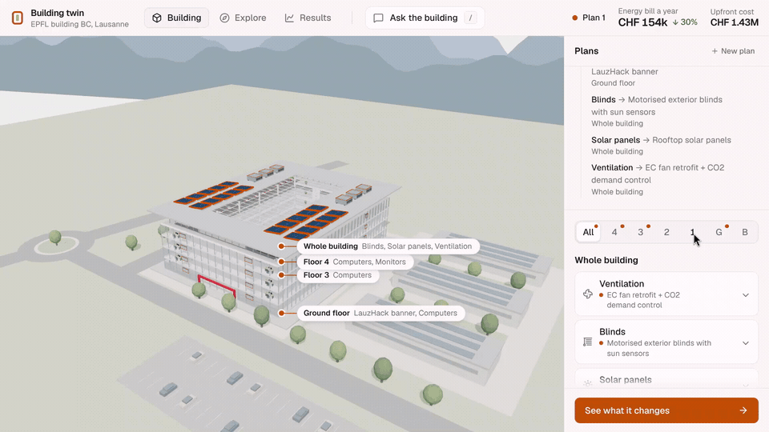

# DigiBuild

Explore a 3D twin of EPFL’s BC building. Try upgrades like better lighting or ventilation and see how they could change energy use, indoor air quality, and costs before spending any money. The building is real; the numbers are demo estimates.

## Run it locally

You’ll need Python 3, Node.js, pnpm 10, and Make. From the project folder:

1. Run `make setup` once to install everything the app needs.
2. Run `make dev` to start the app.
3. Open [localhost:5173](http://localhost:5173) in your browser.

The optional [AI assistant](chat/README.md) needs a Nebius Token Factory key.
