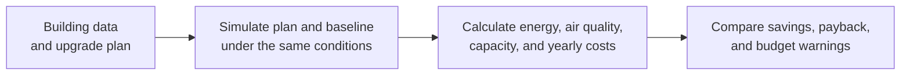

# What-If LauzHack — Technical Report

## 3D model

The React Three Fiber viewer recreates EPFL’s BC building, where LauzHack took place. Users can orbit the building, select a floor, and pick equipment to upgrade. Selecting an option adds an equipment swap to a plan and marks the change in 3D. The building is real; the equipment, occupancy, and costs are demo assumptions, not measured operating data.

## AI assistant

The assistant uses the floor, equipment, or plan on screen to answer questions like “Which upgrade pays back fastest here?” A language model accessed through OpenRouter calls the Python engine for figures rather than calculating them itself. For requests with limits, such as a CHF 200,000 budget, it proposes a goal and constraints for the user to confirm before the server runs the optimizer. The resulting plan can be opened in 3D or compared in Results.

## Simulation engine

The Python engine uses equipment specs, occupancy schedules, and energy prices to simulate each year. For example, better ventilation heat recovery lowers heating demand, while airflow and occupancy determine room CO₂. The baseline replaces worn-out equipment like-for-like, so the comparison does not treat doing nothing as free.

The optimizer uses a fixed run. Results reruns the same model across 200 possible futures, varying factors such as electricity prices, heatwaves, and equipment failures. The chart shows median savings and the middle 80% of simulated outcomes. That range reflects the chosen assumptions, not a forecast.
