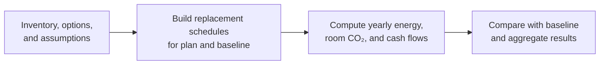

# What-If LauzHack — Technical Report

## 3D model

The React and TypeScript frontend uses React Three Fiber to build the Three.js scene from reusable floor, room, and equipment components. Repeated geometry is drawn with instanced meshes to reduce draw calls. Vite imports the same room, inventory, and option CSVs that the Python engine reads. The frontend sends swaps as structured records with an equipment group, an option ID, and, where applicable, a floor.

## AI assistant

The assistant sends the conversation and active plan to a language model via OpenRouter. The model requests tools with structured arguments; Python runs those tools and returns the calculated figures. For constrained optimization, the model proposes the objective and limits, and the server runs the confirmed problem unchanged. The default search measures individual swaps, combines them using a fast additive approximation, and evaluates candidates against the full engine to capture interactions between upgrades.

## Explore mode

A stateful FastAPI session runs the same Python engine against one scripted or seeded future. Each step advances to the next trigger, such as an equipment failure or a new capacity warning. The session locks completed decisions and accepts edits only to the remaining plan. At the end, it compares the resulting cash flows with a like-for-like baseline in that same future.

## Simulation engine

The Python engine, served through FastAPI, simulates the upgrade plan and a like-for-like replacement baseline over 15 years by default. It calculates electricity use from equipment power and runtime, adjusts heating and cooling for internal heat gains and ventilation heat recovery, and estimates peak room CO₂ from occupancy and fresh airflow. It compares yearly operating and investment costs, including remaining equipment value at the horizon. Discounted differences give net present value; cumulative differences give payback.

The optimizer uses a fixed run. Results uses 200 seeded Monte Carlo draws: electricity prices follow a random walk, events such as heatwaves are sampled, and existing equipment failures follow an age-conditioned Weibull wear-out curve. Every plan and its baseline face the same draws. The chart shows the median and the 10th–90th percentile band of cumulative savings under those assumptions.
